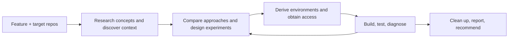

# Explaining the PoC workflow

## A 45-second explanation

“We repeatedly build proofs of concept to understand new features before committing to an implementation. The work includes learning the concepts, reading several repositories, comparing approaches, testing failures, and explaining the tradeoffs. Much of that investigation process is repeated each time.

“This project packages that process as reusable skills for our existing coding agents. We give it the feature and target repositories. It researches the current product and upstream implementations, discovers relevant missing context, and designs experiments. It then asks for the environments those experiments need, builds and tests a small prototype, and produces evidence, a reproducible runbook, and implementation guidance.

“The goal is to make feature decisions better informed and PoCs repeatable. A failed approach is a useful result if the experiment explains why it failed.”

## What exactly have we built?

**Three portable skills, plus a small Python helper.** The agent is the coding assistant already running in Codex, Claude Code, Cursor, or a supported Copilot client. The skills give that agent the investigation workflow. This repository does not run a separate autonomous service.

| Part | Responsibility |
| --- | --- |
| `aew` | Entry point for investigation; routes requests to execute a PoC. |
| `repository-resolution` | Find and pin target and related sources, including dependencies discovered during research. |
| `poc` | Research, compare approaches, design and run experiments, diagnose, clean up, and explain results. |
| `poc.py` | Initialize and validate run records; optionally perform explicitly targeted, read-only Kubernetes preflight. |
| Host agent and tools | Reason about the feature, read sources, write the prototype, and execute commands within the agreed scope. |

The helper does not implement arbitrary features, judge whether evidence is true, or grant access. Feature-specific manifests, code, and tests are produced during each investigation.

## How a run works



Research precedes the cluster request. A library PoC may need no cluster; a deployment PoC may need one; a cross-cluster feature may need several. Environment access is requested with roles, prerequisites, and intended changes. Missing access leaves a resumable run with explicitly untested experiments.

## How to run it

1. Open this repository in a supported agent host. For another project or local Claude Code, follow the [installation instructions](../README.md#installation-and-host-requirements) to link or copy all three skills.
2. Start a new session if needed and invoke `$poc` in Codex, `/poc` where supported, or directly ask the agent to read `.agents/skills/poc/SKILL.md`.
3. Give the problem, target repositories/ref, questions, and constraints. Provide environment paths and explicit contexts when the agent asks after research.

Example:

```text
Use the poc skill to investigate and execute a nested SPIRE PoC.
Target: https://github.com/rausingh-rh/zero-trust-workload-identity-manager,
branch main.
Related sources: spiffe/spire, spiffe/spire-controller-manager, spiffe/spiffe-csi.
Discover any additional relevant source context.
Explain the trust hierarchy and current product support, compare implementation
approaches, and test bootstrap, workload identity, negative controls, restart,
and certificate renewal. Research first, then request the required environments.
Produce evidence, tradeoffs, hard implementation work, and a reproducible runbook.
```

Run output defaults to `.work/pocs/<run-id>/`: `research.md`, `plan.md`, `run.json`, prototype artifacts, sanitized evidence, `runbook.md`, and `report.md`.

To continue later: “Use poc to resume `.work/pocs/<run-id>`.” To remove retained test resources: “Use poc to clean up that run using its resource ledger.”

## A three-minute meeting demo

| Time | Show | Explain |
| --- | --- | --- |
| 0:00–0:40 | The explanation above and the three skills | A reusable engineering investigation workflow. |
| 0:40–1:10 | The nested SPIRE request | The user supplies the decision and starting sources; the agent fills relevant context gaps. |
| 1:10–1:50 | `research.md` and `plan.md` from a run | Pinned code evidence, product gaps, alternatives, and tests that could disprove an approach. |
| 1:50–2:30 | An evidence file beside its report claim | Show what was actually executed and what remains untested. |
| 2:30–3:00 | `runbook.md` and the next action in `run.json` | Reproducibility, cleanup, and continuation when access becomes available. |

Use saved artifacts for the meeting; a live deployment is unnecessary to explain the workflow. The nested SPIRE pilot used two independent OpenShift clusters and the exact target `main` commit. Show its [case study](../examples/nested-spire-live-validation.md) alongside the [validation record](validation.md).

A concise pilot explanation: “The agent found that upstream SPIRE supports nesting but ZTWIM does not expose it natively. It proved a manually configured hierarchy with cross-cluster mutual TLS and JWT validation, then tested permission removal, restart and outage behavior. It found real integration risks: old signing state, credential expiry, single-use bootstrap and operator reconciliation. Those results tell us what product engineering must implement.”

## Likely questions

- **Why not a normal prompt?** The skills preserve a repeatable process, evidence format, environment targeting, cleanup, and resume behavior across investigations. The agent still reasons about each feature.
- **Is it specific to SPIRE/OpenShift?** The core workflow is general. SPIRE examples and OpenShift mappings are optional domain context.
- **Does it handle missing repositories?** It follows relevant source/dependency/design links and records provenance. Ambiguous or inaccessible context is surfaced explicitly.
- **Is every host tested?** Instructions are portable; execution and skill discovery depend on each client's capabilities. The validation record distinguishes executed tests from compatibility guidance.
- **Can it guarantee any feature works?** No. It can establish what worked under tested conditions, reject an approach, or explain the exact blocker and next experiment.
- **What is the success measure?** Questions answered with evidence, approaches ruled in/out, reproducible commands, and implementation risks identified. We have not yet measured time savings across teams.
